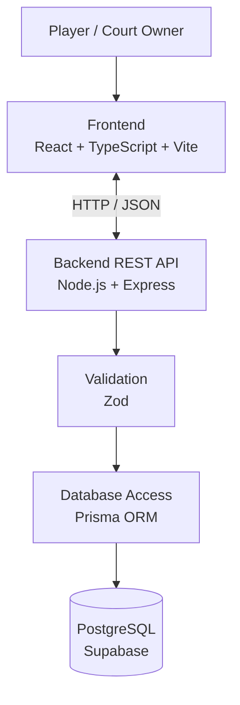

# Courtly 🏸

**A badminton court booking platform built with TypeScript.**

Courtly is a full-stack web application project designed to make booking badminton courts easier. Players will be able to explore courts, check available time slots, and manage reservations, while court owners will be able to manage their facilities and bookings.

> **Project Status:** In Development  
> This project is currently in its early development stage. Features listed below are planned unless explicitly marked as implemented.

## Table of Contents

- [Overview](#overview)
- [Features](#features)
- [Technology Stack](#technology-stack)
- [Architecture](#architecture)
- [Getting Started](#getting-started)
- [Environment Variables](#environment-variables)
- [Database Setup](#database-setup)
- [Planned API Endpoints](#planned-api-endpoints)
- [Testing](#testing)
- [Security](#security)
- [Roadmap](#roadmap)
- [Contributing](#contributing)
- [License](#license)
- [Author](#author)

## Overview

Finding and booking a badminton court can involve contacting venues individually or relying on informal messaging. This makes checking availability and managing reservations inconvenient.

Courtly aims to provide a centralized platform where players can discover courts, select available time slots, and manage their bookings. Court owners will also have tools to manage their courts and monitor reservations.

The project serves as a practical learning experience in full-stack development, REST API design, database modeling, authentication, automated testing, and booking conflict prevention.

## Features

The following features are planned for development.

### Player

- Browse and search badminton courts.
- View court details, locations, and hourly prices.
- Check available time slots by date.
- Book available court time slots.
- View booking history.
- Cancel eligible reservations.

### Court Owner

- Add and manage badminton courts.
- Configure court availability and time slots.
- View and manage reservations.
- Monitor booking activity.

### System

- User authentication and role-based authorization.
- Input validation and error handling.
- Prevention of duplicate bookings.
- Automated tests for critical business logic.

## Technology Stack

| Component | Technology |
|---|---|
| Frontend | React, TypeScript, Vite |
| Backend | Node.js, Express.js, TypeScript |
| Database | PostgreSQL |
| Database Hosting | Supabase |
| ORM | Prisma |
| Validation | Zod |
| Testing | Vitest, Supertest |
| Version Control | Git, GitHub |
| Planned Frontend Deployment | Vercel |
| Planned Backend Deployment | Node.js-compatible hosting |

*The stack represents the planned implementation and may change during development.*

## Architecture

Courtly is planned as a three-tier web application.



**Architecture responsibilities:**

- **Frontend:** Provides the user interface for browsing courts and managing bookings.
- **Backend:** Handles API requests, authentication, authorization, and booking logic.
- **Validation:** Validates incoming request data before business logic processes it.
- **Database:** Stores users, courts, time slots, and booking records.
- **ORM:** Prisma provides database access and schema management.

## Getting Started

The following instructions describe the intended local development setup. They assume that the frontend and backend projects have been created and that the required scripts are configured.

### Prerequisites

Install the following tools:

- [Node.js](https://nodejs.org/en/download/)
- npm, included with Node.js
- [Git](https://git-scm.com/downloads)
- [Visual Studio Code](https://code.visualstudio.com/)
- A [Supabase](https://supabase.com/) account for the planned database

Verify your installations in PowerShell:

```powershell
node --version
npm --version
git --version
```

### 1. Clone the Repository

Replace the repository URL below with the actual URL of this repository.

```powershell
git clone https://github.com/makeit-master/Courtly-Badminton-Court-Booking-System.git
cd Courtly-Badminton-Court-Booking-System
```

### 2. Install Dependencies

Once the `client` and `server` directories contain their respective `package.json` files, install their dependencies:

```powershell
cd server
npm install

cd ..\client
npm install
```

### 3. Configure Environment Variables

Create the backend environment file using the example template described in [Environment Variables](#environment-variables).

### 4. Start the Development Servers

After the development scripts have been configured, run the backend and frontend in separate terminal windows.

**Backend:**

```powershell
cd server
npm run dev
```

**Frontend:**

```powershell
cd client
npm run dev
```

The frontend's local URL is typically `http://localhost:5173`. The backend URL depends on its configured port.

*Note: These commands will become usable once the corresponding applications and npm scripts are implemented.*

## Environment Variables

Backend configuration should be stored in `server/.env`. Do not commit real credentials or secrets to GitHub.

A proposed `server/.env.example`:

```dotenv
PORT=4000
NODE_ENV=development

DATABASE_URL="your-postgresql-connection-string"

JWT_SECRET="replace-with-a-long-random-secret"
JWT_EXPIRES_IN="1d"

CLIENT_ORIGIN="http://localhost:5173"
```

If the frontend needs a configurable API URL, use `client/.env.example`:

```dotenv
VITE_API_BASE_URL="http://localhost:4000/api"
```

**Important:** Vite exposes variables prefixed with `VITE_` to client-side code. Never put database credentials, private keys, or other secrets in frontend environment variables.

Ensure `.gitignore` excludes sensitive environment files:

```gitignore
node_modules/
dist/
coverage/

.env
.env.*
!.env.example
```

## Database Setup

The planned database is PostgreSQL hosted on Supabase, with Prisma used for schema management and database access.

Once Prisma has been configured in the backend:

1. Create a PostgreSQL project in Supabase.
2. Obtain the appropriate database connection string.
3. Configure `DATABASE_URL` in `server/.env`.
4. Define the database models in the Prisma schema.
5. Generate the Prisma Client and create the initial migration.

Typical development commands are:

```powershell
cd server

npx prisma generate
npx prisma migrate dev --name init
npx prisma studio
```

These commands assume a compatible Prisma setup. The exact configuration may differ by Prisma version.

## Planned API Endpoints

The following REST API endpoints describe the intended interface. They are **not claimed to be implemented**.

| Method | Endpoint | Purpose |
|---|---|---|
| POST | `/api/auth/register` | Register a user |
| POST | `/api/auth/login` | Authenticate a user |
| GET | `/api/courts` | List and search courts |
| GET | `/api/courts/:id` | View court details |
| GET | `/api/courts/:id/slots?date=YYYY-MM-DD` | Check time-slot availability |
| POST | `/api/courts` | Create a court |
| PATCH | `/api/courts/:id` | Update a court |
| DELETE | `/api/courts/:id` | Delete a court |
| POST | `/api/bookings` | Create a booking |
| GET | `/api/bookings/me` | View personal bookings |
| PATCH | `/api/bookings/:id/cancel` | Cancel an eligible booking |
| GET | `/api/owner/bookings` | View bookings for owned courts |

Access to protected endpoints will depend on authentication, user roles, and resource ownership.

## Testing

Automated testing is planned using Vitest and Supertest.

The intended test coverage includes:

- Authentication and authorization.
- Court listing and management.
- Booking creation and cancellation.
- Invalid requests and error handling.
- Prevention of duplicate bookings under concurrent requests.

Once the test scripts are configured, run the backend tests with:

```powershell
cd server
npm test
```

No test results are claimed until the tests have been implemented and executed.

## Security

Security is an important consideration for a booking application. Planned measures include:

- Hash passwords using a suitable password-hashing algorithm.
- Validate incoming requests with Zod.
- Enforce authentication and role-based authorization on the server.
- Verify that users can only access or modify resources they are authorized to manage.
- Keep secrets in environment variables and exclude `.env` files from version control.
- Enforce booking conflict prevention at the database level and handle concurrent booking attempts safely.
- Configure CORS to allow trusted origins.
- Return appropriate error messages without exposing sensitive internal details.

These are development goals, not claims that the measures are already implemented.

## Roadmap

- [ ] **Phase 1:** Initialize the frontend and backend projects.
- [ ] **Phase 2:** Configure PostgreSQL, Prisma, and database models.
- [ ] **Phase 3:** Implement registration, login, and authorization.
- [ ] **Phase 4:** Build court listing, search, and management.
- [ ] **Phase 5:** Implement booking, cancellation, and conflict prevention.
- [ ] **Phase 6:** Build the frontend and integrate the API.
- [ ] **Phase 7:** Add automated tests and improve error handling.
- [ ] **Phase 8:** Deploy the application and document the completed system.

Future improvements may include online payments, court reviews, notifications, and owner analytics.

## Contributing

Courtly is a personal learning project, and suggestions are welcome.

For proposed improvements:

1. Open an issue describing the change or problem.
2. Create a feature branch.
3. Make focused changes and test them.
4. Submit a pull request with a clear description.

Please avoid committing secrets, generated dependencies, or unrelated changes.

## License

No license has been selected yet. Until a license is added, the project should be treated as all rights reserved by its author.

## Author

**GitHub:** [@makeit-master](https://github.com/makeit-master)
